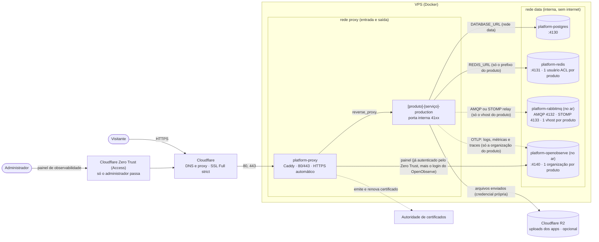
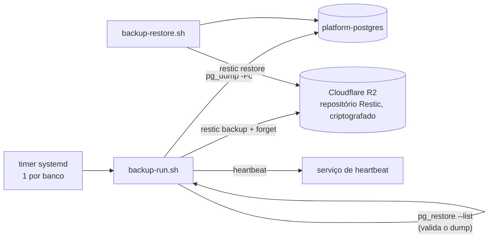
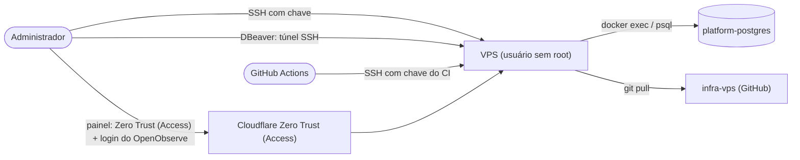

# Diagrama da plataforma

Mapa de tudo que roda e de como as peças se falam. Os diagramas abaixo são texto (Mermaid) e o GitHub os desenha.

> **Regra: todo escopo novo atualiza este diagrama no mesmo trabalho.** Serviço de plataforma novo (`platform/`), tipo novo de app, banco, domínio, integração externa, rotina de backup ou etapa de pipeline entram aqui **antes** de o trabalho ser dado como concluído. O `scripts/validate.sh` falha se um serviço de `platform/` não aparecer em `docs/diagrama.md`. A fonte versionada é `docs/diagrama.md` no repositório; esta página é a mesma cópia, para leitura na Wiki.

## 1. Arquitetura (o que roda e em quais redes)

| Serviço | Pasta | Redes | Porta interna | Publicada no host |
|---|---|---|---|---|
| proxy | `platform/proxy` | proxy | — | 80, 443, 443/udp |
| postgres | `platform/postgres` | data | 4130 | não |
| redis | `platform/redis` | data | 4131 | não |
| rabbitmq | `platform/rabbitmq` | data | 4132, 4133, 4134 | não |
| observability / openobserve | `platform/observability` | data, proxy | 4140, 4141 | não |
| app (um por produto e serviço) | `apps/<produto>/production/<serviço>` | proxy, data | 4100–4129 | não |

## 2. CI/CD (do push ao ar)

## 3. Dados e backup

## 4. Acesso administrativo

Notas de segurança:

- **Zero Trust:** o painel de observabilidade só é alcançado depois de uma política do Cloudflare Zero Trust (Access) que libera o administrador; o login do OpenObserve é a segunda camada. Nenhuma porta de administração fica aberta na VPS: o acesso é por SSH com chave ou por túnel SSH.
- **R2:** é o único armazenamento de objetos da plataforma. Os **uploads** dos apps e os **backups** (repositório Restic, criptografado) usam credenciais separadas (as dos apps ficam no secret de cada aplicação; as do backup, em `platform/backup`).

## 5. Onde cada escopo está documentado

Veja a [Wiki](https://github.com/Trinket-OS-BR/infra-vps/wiki), páginas 1 a 18.

## 6. Como atualizar

1. Edite `docs/diagrama.md` no repositório: acrescente o serviço ao diagrama 1 e à tabela, e as etapas ou ligações novas aos outros.
2. Rode `scripts/validate.sh`: ele acusa serviço que ainda não está no diagrama.
3. Copie o conteúdo para esta página (mantenha a regra do topo).
4. Registre a mudança no histórico abaixo.

## 7. Histórico

| Data | Mudança |
|---|---|
| 2026-10-29 | Versão inicial: proxy, postgres, app, CI/CD, backup e acesso administrativo. |
| 2026-10-29 | Redis compartilhado com isolamento por usuário ACL e prefixo de chave. |
| 2026-10-29 | RabbitMQ com STOMP preparado (desligado): um vhost e um usuário por produto. |
| 2026-10-29 | OpenObserve preparado (desligado): logs, métricas e traces por OTLP, uma organização e um usuário por produto. |
| 2026-10-29 | OpenObserve no ar: o painel sai pelo proxy atrás de uma camada de acesso (controle de acesso do DNS/CDN, só o administrador); os apps enviam traces pela rede `data`; alertas por organização com destino de chat. |
| 2026-10-29 | RabbitMQ no ar (um vhost por produto). TrinketOS API ganha receita em `apps/trinketos/production/api`: dados pela rede `data`, credenciais de infraestrutura só na VPS, deploy pelo padrão de etapas reutilizáveis. |
| 2026-10-30 | TrinketOS web ganha receita em `apps/trinketos/production/web` (porta 4111): chama a API pela rede `data`; telemetria pronta, ligada só ao criar o arquivo de observabilidade do serviço. |
| 2026-10-30 | TrinketOS Workspace ganha receita em `apps/trinketos/production/workspace` (porta 4112): painel que só fala com a API pela rede `data` (sem banco, Redis nem RabbitMQ); telemetria pronta, desligada. |
| 2026-10-30 | TrinketOS design ganha receita em `apps/trinketos/production/design` (porta 4113): Storybook estático em nginx, só rede `proxy`, sem dados nem API. |
| 2026-10-30 | Diagramas passam a nomear o Cloudflare R2 (uploads e backups) e o Cloudflare Zero Trust (Access) na frente do painel de observabilidade. |
| 2026-10-30 | TrinketOS learn ganha receita em `apps/trinketos/production/learn` (porta 4114): Next.js que só fala com a API pela rede `data` (sem banco, Redis nem RabbitMQ); telemetria pronta, desligada. |
| 2026-10-31 | Ebooks (site de venda dos guias) ganha receita em `apps/ebooks/production/web` (porta 4121): Caddy servindo arquivos estáticos, só rede `proxy`, sem dados nem API; bloco do proxy em `sites-disponiveis/ebooks.caddy` (desligado até o DNS apontar). |
| 2026-10-31 | Ebooks envia um trace por requisição ao OpenObserve (organização `ebooks`, gRPC na 4141, pela rede `data`); credenciais em `/srv/secrets/ebooks-web-observability.env`. |
| 2026-11-01 | Portfólio (antoniobsilva.com.br) ganha receita em `apps/portfolio/production/web` (porta 4122): Caddy servindo arquivos estáticos, só rede `proxy`, sem dados nem API; bloco do proxy em `sites-disponiveis/portfolio.caddy` (desligado até o DNS apontar). |
| 2026-11-01 | Portfólio envia um trace por requisição ao OpenObserve (organização `portfolio`, gRPC na 4141, pela rede `data`); credenciais em `/srv/secrets/portfolio-web-observability.env`. |
