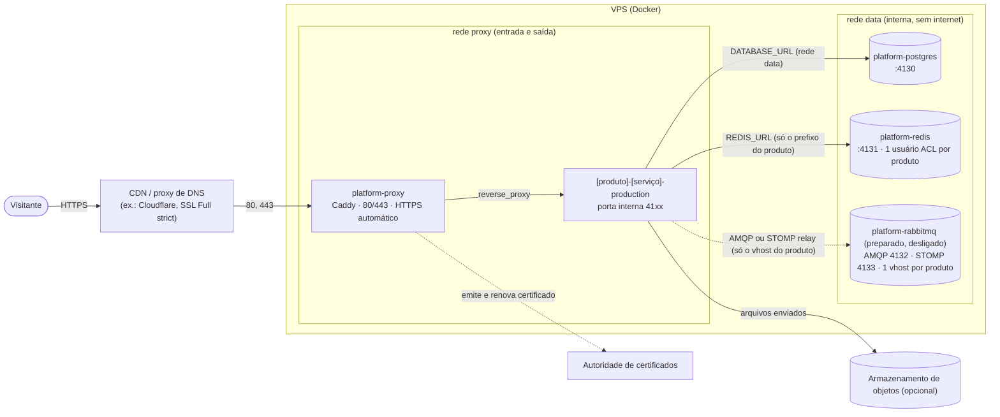
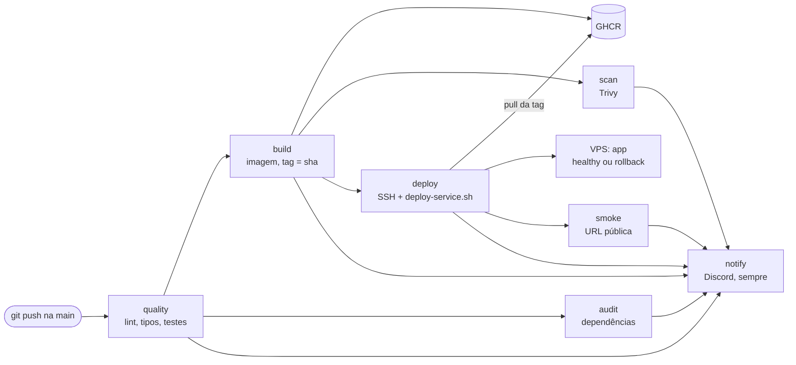
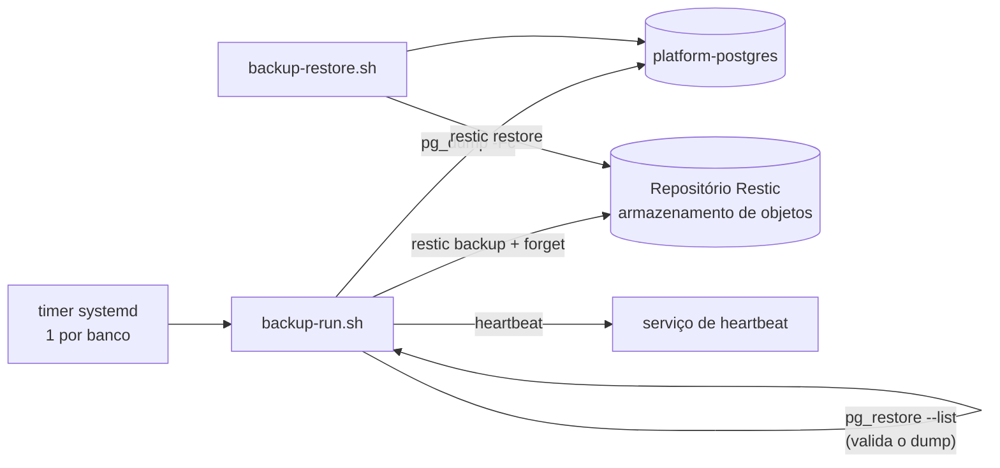
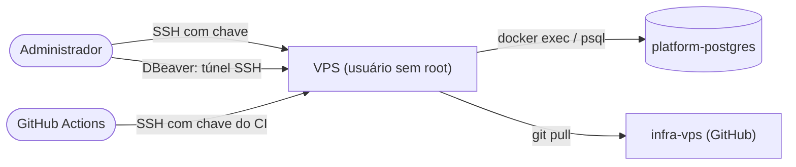

# Diagrama da plataforma

Mapa de tudo que roda e de como as peças se falam. Os diagramas abaixo são texto (Mermaid) e o GitHub os desenha.

> **Regra: todo escopo novo atualiza este diagrama no mesmo trabalho.** Serviço de plataforma novo (`platform/`), tipo novo de app, banco, domínio, integração externa, rotina de backup ou etapa de pipeline entram aqui **antes** de o trabalho ser dado como concluído. O `scripts/validate.sh` falha se um serviço de `platform/` não aparecer em `docs/diagrama.md`. A fonte versionada é `docs/diagrama.md` no repositório; esta página é a mesma cópia, para leitura na Wiki.

## 1. Arquitetura (o que roda e em quais redes)

| Serviço | Pasta | Redes | Porta interna | Publicada no host |
|---|---|---|---|---|
| proxy | `platform/proxy` | proxy | — | 80, 443, 443/udp |
| postgres | `platform/postgres` | data | 4130 | não |
| redis | `platform/redis` | data | 4131 | não |
| rabbitmq (preparado) | `platform/rabbitmq` | data | 4132, 4133, 4134 | não |
| app (um por produto e serviço) | `apps/<produto>/production/<serviço>` | proxy, data | 4100–4129 | não |

## 2. CI/CD (do push ao ar)

## 3. Dados e backup

## 4. Acesso administrativo

## 5. Onde cada escopo está documentado

Veja a [Wiki](https://github.com/Trinket-OS-BR/infra-vps/wiki), páginas 1 a 17.

## 6. Como atualizar

1. Edite `docs/diagrama.md` no repositório: acrescente o serviço ao diagrama 1 e à tabela, e as etapas ou ligações novas aos outros.
2. Rode `scripts/validate.sh`: ele acusa serviço que ainda não está no diagrama.
3. Copie o conteúdo para esta página (mantenha a regra do topo).
4. Registre a mudança no histórico abaixo.

## 7. Histórico

| Data | Mudança |
|---|---|
| 2026-10-29 | Versão inicial: proxy, postgres, app, CI/CD, backup e acesso administrativo. |
| 2026-10-29 | Redis compartilhado com isolamento por usuário ACL e prefixo de chave. |
| 2026-10-29 | RabbitMQ com STOMP preparado (desligado): um vhost e um usuário por produto. |
